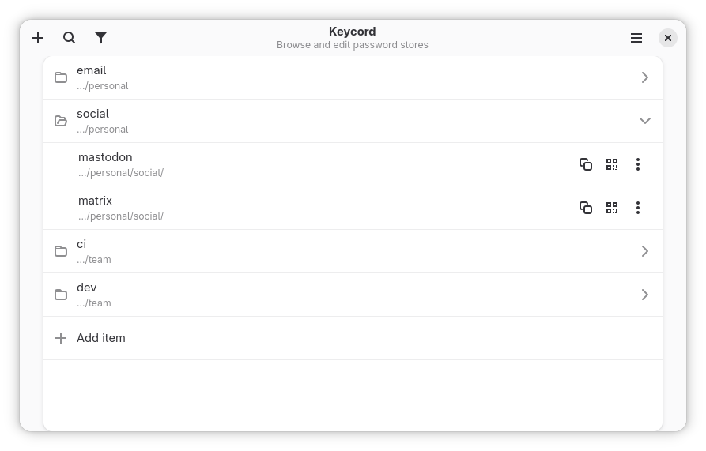

# Keycord


[](https://flathub.org/apps/details/io.github.noobping.keycord)
[](https://hosted.weblate.org/engage/keycord/)
[](https://github.com/noobping/keycord/actions/workflows/linux.yml)
[](https://github.com/noobping/keycord/actions/workflows/win.yml)

Keycord is an adaptive graphical client for password folders that use the standard
[`pass`](https://www.passwordstore.org/) layout. Existing stores remain normal pass stores on disk,
so they keep working with `pass` and other compatible tools.

- Open one or more password stores and search by name, store, field, regular expression, or structured `find` query
- Edit entries with form fields or raw pass-file text, generate passwords, and copy or show passwords, usernames, and one-time codes as QR codes
- Add existing stores, create new stores, import passwords on supported systems, or restore a store from Git with the Host backend
- Manage store recipients, folder-specific `.gpg-id` files, and password-protected private keys, including file and clipboard imports and optional host GPG synchronization
- Find weak passwords, browse repeated field values, filter by store, and export password stores to CSV
- Sync Git-backed stores, manage remotes, sign changes, and inspect history with commit verification details
- Use the adaptive GTK interface with keyboard, mouse, or touch across desktop and mobile devices



## Documentation

Start with the [Getting Started guide](crates/keycord-docs/docs/getting-started.md), then explore the following sections:

- [Search](crates/keycord-docs/docs/search.md): how to find outdated or insecure accounts
- [Workflows](crates/keycord-docs/docs/workflows.md): how to do things in Keycord
- [Permissions and Backends](crates/keycord-docs/docs/permissions-and-backends.md): application environment
- [Use Cases](crates/keycord-docs/docs/use-cases.md): practical examples and short tutorials
- [Teams, Workgroups, and Organizations](crates/keycord-docs/docs/teams-and-organizations.md): manage shared stores and collaboration

## Translation

You can translate Keycord using [weblate](https://hosted.weblate.org/projects/keycord) which makes it possible to translate from your browser. Simply register and start translating.

## Development

### AppImage

The AppImage workflow builds x86-64 and ARM64 packages on Ubuntu 26.04.
Pull requests and manual runs provide test artifacts; matching `v*` version
tags attach AppImages, SHA-256 checksums and zsync files to the GitHub release
after both architectures pass. Existing native Linux builds remain available.

To build locally, install the dependencies in `.github/workflows/appimage.yml`
and run `./build-aux/appimage/build.sh` from a clean checkout.

The bundle includes GTK/libadwaita, linked libraries, Git, translations, icons,
settings schemas and MIME data. It enables docs, audit, smartcard, passkey,
passless and logging features. The standalone self-installer/updater is disabled
because it cannot install or replace a mounted AppImage correctly. GNOME search
provider registration is not installed by the portable package.

The integrated backend runs inside the bundle. Optional host backends still use
your system's `pass`, GnuPG, pinentry and extensions; SSH remotes use your system's
SSH client/agent, and smartcards need the host PC/SC service. These commands keep
their host libraries and configuration. The launcher defaults to the Cairo
renderer and respects an explicit `GSK_RENDERER`.

CI checks a real window and bundled Git operations on clean Ubuntu 22.04 and
24.04 containers, using isolated settings and no network. Password-store
operations and hardware integrations should also be checked on a desktop before
publishing a release.

The root package is the application composition layer; implementation is split into subject crates. See [ARCHITECTURE.md](ARCHITECTURE.md) for ownership and dependency rules.

Package names differ by distribution. This project was tested with Fedora packages:

```sh
sudo dnf install gpgme-devel clang pkg-config pkgconf-pkg-config nettle-devel libgpg-error-devel openssl-devel gtk4-devel gdk-pixbuf2-devel gcc gcc-c++ make gettext glib2-devel cairo-devel capnproto capnproto-devel pcsc-lite-devel pango-devel libadwaita-devel cargo mold clippy rustfmt \
    cmake pcsc-lite pcsc-lite-ccid systemd-devel git pass pass-otp pinentry pinentry-gnome3 python-pass-import
```
